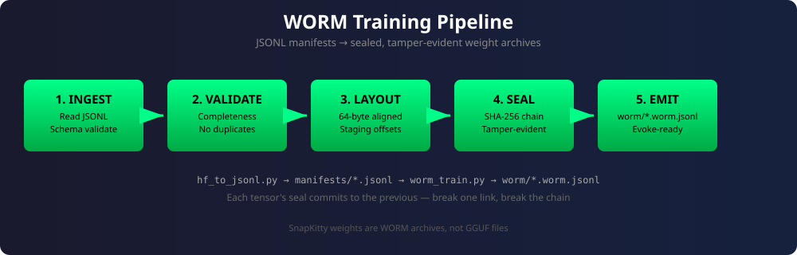
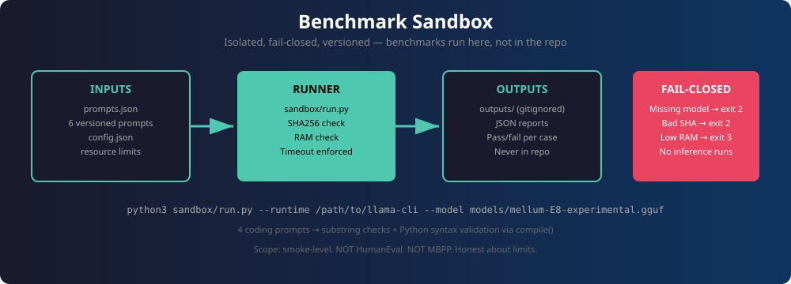
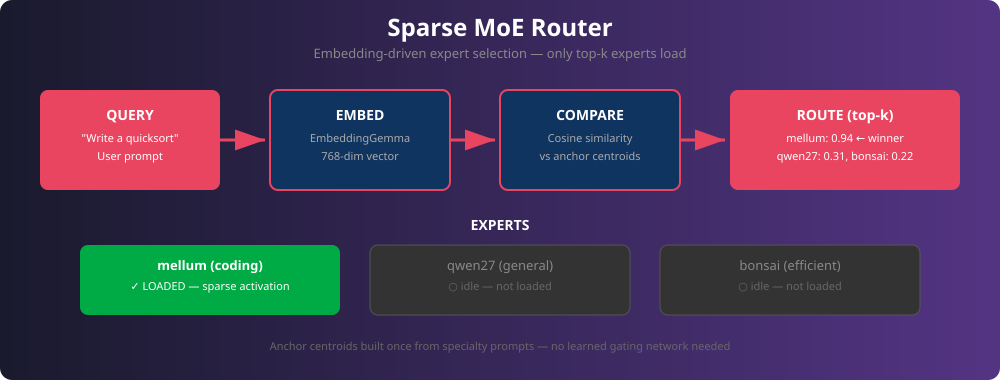

<!--
  Copyright (C) 2026 Ahmad Ali Parr
  SPDX-License-Identifier: AGPL-3.0-only
-->

# GGUF Lab — October 2026 Drops

## Current 2 GiB NUC workflow

See [NUC-2GB.md](NUC-2GB.md) for the bounded-memory streaming pipeline, model
audit, experimental Mellum expert pruning and CPU-only profiles. The six-model
main-rig inventory below remains a research inventory; it is not a claim that
those models fit a 2 GiB GPU. `pull.sh` defaults to the small embedding model.
Pruning an altered model does not establish its coding or tool-use quality.

Pruning + compression lab for the October 2026 GGUF releases.
Staged here, executed on real hardware (this VM has no GPU and cannot
hold these models — pull and run happen on the NUC fleet / main rig).

## The six drops (all verified live on HuggingFace)

| # | Model | HF repo (GGUF) | Params | Pick for |
|---|---|---|---|---|
| 1 | Qwen3.8-27B | `unsloth/Qwen3.8-27B-GGUF` | 27B dense | Coding / agents |
| 2 | Qwen3.8 Flash Next | `ISTA-DASLab/Qwen3.8-Flash-Next-GSQ-RCO-GGUF` | 177B MoE | Low-bit MoE research (offload only) |
| 3 | Ternary Bonsai 2 27B | `prism-ml/Ternary-Bonsai-2-27B-gguf` | 27B ternary | Weight-compression research |
| 4 | Mellum 2.1 Thinking | `JetBrains/Mellum2.1-12B-A2.5B-Thinking-GGUF` | 12B / 2.5B active MoE | Coding, fits small VRAM |
| 5 | EmbeddingGemma 2 | `unsloth/embeddinggemma-2-GGUF` | 300M | Retrieval / agent memory |
| 6 | Xing 4.0 29B-A4B | `XingChen-AGI/Xing4.0-29B-A4B-GGUF` | 29B / 4B active MoE | Perf-per-token |

Key files (verified in repo listings):
- Qwen3.8-27B: `Qwen3.8-27B-UD-Q4_K_M.gguf`, `Qwen3.8-27B-UD-Q4_K_S.gguf`, `Qwen3.8-27B-Q8_0.gguf`
- Mellum 2.1: `Mellum2.1-12B-A2.5B-Thinking-Q4_K_M.gguf` (official JetBrains)
- EmbeddingGemma 2: via `unsloth/embeddinggemma-2-GGUF` or `ggml-org/embeddinggemma-2-GGUF`

## Hardware mapping

| Hardware | Target models |
|---|---|
| NUC (11B cap) | EmbeddingGemma 2, Mellum 2.1 Q4 (offload) |
| 2nd NUC (arrives tomorrow) | Pipeline-split candidate |
| Main rig (big VRAM) | Qwen3.8-27B, Xing 4.0, Ternary Bonsai 2, Glimmer 30B |
| 177B Flash Next | Offload-only everywhere; research target, not daily driver |

## Pipeline



The full flow, from HuggingFace to sealed weights:

```
pull.sh → pull GGUFs to local store
   │
scripts/hf_to_jsonl.py → JSONL tensor manifests
   │   Remote header indexing (no full download).
   │   One JSON object per line: name, shape, dtype, offset.
   │   Output: manifests/*.jsonl (5 models, 3,446 tensors)
   │
scripts/worm_train.py → WORM metadata training pipeline
   │   5 stages: ingest → validate → layout → seal → emit
   │   Output: worm/*.worm.jsonl (sealed archive descriptors)
   │
   │   These are the weights: sealed, tamper-evident, evoke-ready.
   │   SnapKitty doesn't use GGUF files as weights — it uses WORM archives.
   │
prune/plan.md → structured pruning per model (layer drop, width, heads)
   │
compress/plan.md → quantization targets (Q4_K_M baseline, ternary study)
   │
sandbox/ → isolated benchmarks + sparse MoE router (see below)
   │
GGUF out → Ollama / llama.cpp
```

### WORM training pipeline

SnapKitty doesn't use GGUF files as weights. Weights are **WORM archives**:
sealed, immutable, memory-mapped tensor stores (see `glm-evoke/src/worm.rs`).

`scripts/worm_train.py` trains JSONL manifests into sealed archives through
5 stages:

| Stage | What it does |
|---|---|
| **Ingest** | Read JSONL, schema-validate every line |
| **Validate** | Check completeness, reject duplicates and count mismatches |
| **Layout** | Compute 64-byte aligned WORM staging offsets |
| **Seal** | SHA-256 hash chain — each tensor commits to the previous seal |
| **Emit** | Write sealed archive descriptor to `worm/*.worm.jsonl` |

```sh
# Single model
python3 scripts/worm_train.py --manifest manifests/mellum.jsonl \
    --out worm/mellum.worm.jsonl

# All models
python3 scripts/worm_train.py --all --out-dir worm/
```

Sealed so far (root seals in `worm/`):

| Model | Tensors | Staged | Root seal |
|---|---|---|---|
| embed | 413 | 0.14 GB | `cc733be4…` |
| mellum | 339 | 6.64 GB | `98b6d089…` |
| qwen27 | 866 | 19.18 GB | `8f8a3a74…` |
| bonsai | 851 | 25.08 GB | `3a187193…` |
| xing | 977 | 18.69 GB | `3cbf2ad1…` |

## Benchmarks



Benchmarks run in `sandbox/` — an isolated environment, not in the repo root.

**What it is:** 6 hand-written coding prompts with substring checks and Python
syntax validation. Fail-closed: missing model, bad SHA256, or low RAM aborts
before any inference runs.

**What it is not:** This is a smoke test, not a benchmark suite. It is not
HumanEval, not MBPP, not a general coding evaluation. Passing these checks
does not establish coding competence.

```sh
python3 sandbox/run.py \
  --runtime /path/to/llama-cli \
  --model models/mellum-E8-experimental.gguf \
  --expected-sha256 <sha256>
```

Reports go to `sandbox/outputs/` (gitignored). See `sandbox/README.md`.

## Sparse MoE Router



`sandbox/moe/router.py` routes queries to experts using embeddings — no
learned gating network needed.

**How it works:**
1. EmbeddingGemma (768-dim) embeds the incoming query
2. Cosine similarity against pre-computed anchor centroids per expert
3. Top-k experts selected — only winners load (sparse activation)

**Experts:** mellum (coding), qwen27 (general), bonsai (efficient).
Anchor prompts in `sandbox/moe/experts.json` define each specialty.

```sh
# Build centroids once (needs llama-server with --embedding)
python3 sandbox/moe/router.py --build-centroids

# Route and run
python3 sandbox/moe/router.py --query "Write a quicksort in Python" \
  --run --runtime /path/to/llama-cli
```

## Contents

- `MANIFEST.md` — full model inventory with arch notes
- `pull.sh` — download commands (run on the target machine)
- `prune/plan.md` — pruning plan per model
- `compress/plan.md` — compression/quantization plan
- `scripts/hf_to_jsonl.py` — HF GGUF → JSONL tensor manifests (remote indexing)
- `scripts/worm_train.py` — WORM metadata training pipeline (sealed archives)
- `scripts/benchmark_mellum.py` — Mellum coding benchmark harness
- `manifests/` — JSONL tensor manifests (5 models, 3,446 tensors)
- `worm/` — sealed WORM archive descriptors
- `sandbox/` — isolated benchmark env + sparse MoE router
  - `sandbox/run.py` — fail-closed benchmark runner
  - `sandbox/moe/router.py` — embedding-driven sparse expert routing
  - `sandbox/inputs/prompts.json` — versioned benchmark prompts
  - `sandbox/config.json` — resource limits and runtime flags
- `tests/test_sandbox.py` — router/cosine/config edge cases (13 tests)
- `tests/test_worm_train.py` — pipeline tests incl. tamper detection (12 tests)

## License

AGPL-3.0-only. Tools referenced (sovereign-mimo-4b, tensor-roll) keep
their own licenses.

**No AI training:** no file in this repository may be used to train,
fine-tune, or distill machine learning models.

**Commercial use** requires a separate license — see [COMMERCIAL.md](COMMERCIAL.md).
Contact: **a.parr@belespritaccord.uk**
